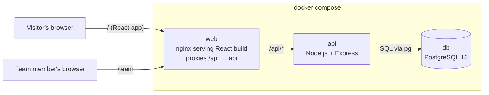
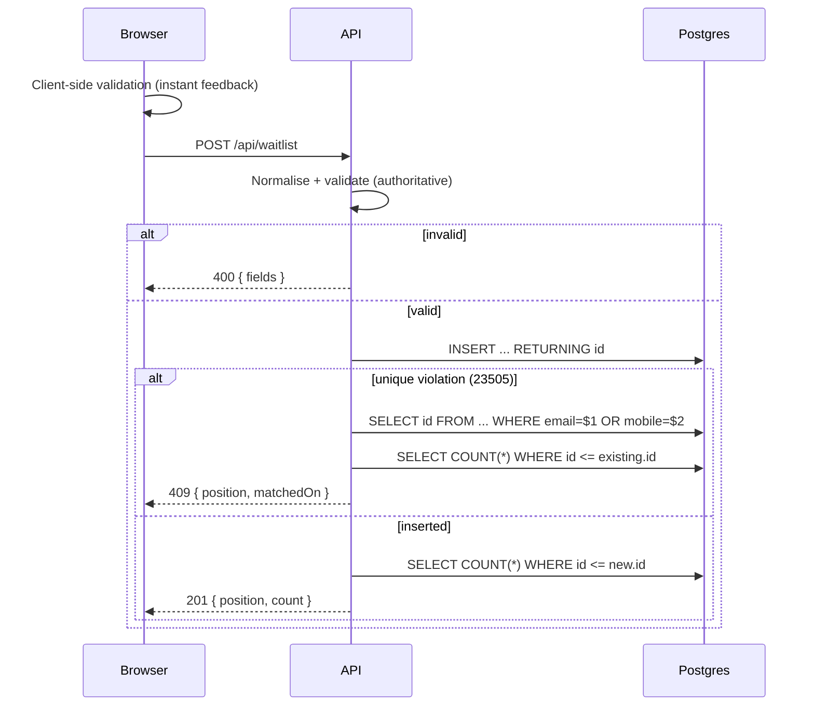

# Weekendly Waitlist: Technical Approach & Architecture

This document describes how the Weekendly waitlist app will be built, and why. It covers the architecture, data model, API, validation rules, security for the team view, Docker setup, and a time plan for the ~90-minute budget.

---

## 1. Goals and constraints

| From the brief | What it means for the design |
|---|---|
| React frontend, Node.js backend, PostgreSQL | Three services, nothing extra (no Redis, no queue). |
| Runs with a single `docker compose up` | Sensible defaults for every env var; DB schema created automatically; backend waits for DB to be healthy. |
| Same email or mobile can't join twice | Enforced by **unique indexes in the database**, not just app code, so it is race-safe. |
| Show position after joining / on duplicate | Position is computed from insertion order, so it is stable and the same on every request. |
| Clear errors so the user can fix them | Backend returns errors **per field**; the form shows each one next to its input. |
| Team view, only the team can open it | Password-protected admin area with a session cookie; CSV export behind the same guard. |
| ~90 minutes | Keep the stack small and boring: Express, `pg`, Vite + React, plain CSS. No ORM, no UI kit. |

---

## 2. High-level architecture



**Three containers:**

1. **`web`**: React app built with Vite (multi-stage Dockerfile), served by nginx. nginx also proxies `/api/*` to the backend, so the browser sees **one origin**: no CORS setup, and the session cookie works without extra config.
2. **`api`**: Node.js (Express). Handles validation, business rules, auth for the team view, and CSV export. Creates the schema on startup.
3. **`db`**: PostgreSQL 16 with a named volume for persistence and a healthcheck.

The app is exposed on **http://localhost:8080**. The database is also published on **localhost:5433** so the data can be browsed with pgAdmin or `psql` (5432 is often taken by a locally installed Postgres).

---

## 3. Repository layout

```
weekendly/
├── docker-compose.yml
├── .env.example              # all variables, with safe local defaults
├── README.md                 # how to run, decisions, AI usage, improvements, time taken
├── TECHNICAL_APPROACH.md     # this file
├── backend/
│   ├── Dockerfile
│   ├── package.json
│   └── src/
│       ├── index.js          # app bootstrap, middleware, start server
│       ├── db.js             # pg Pool + schema init
│       ├── schema.sql        # CREATE TABLE / INDEX IF NOT EXISTS
│       ├── validation.js     # normalise + validate signup payload
│       ├── routes/
│       │   ├── waitlist.js   # public endpoints
│       │   └── admin.js      # team endpoints (login, list, CSV)
│       ├── auth.js           # session cookie sign/verify, requireAdmin middleware
│       └── csv.js            # CSV building with escaping
└── frontend/
    ├── Dockerfile            # build with Vite → serve with nginx
    ├── nginx.conf            # SPA fallback + /api proxy
    ├── package.json
    └── src/
        ├── main.jsx
        ├── App.jsx           # routes: "/" and "/team"
        ├── api.js            # small fetch wrapper
        ├── pages/
        │   ├── WaitlistPage.jsx
        │   └── TeamPage.jsx
        ├── components/       # Field, CheckboxGroup, SuccessCard, etc.
        └── styles.css
```

---

## 4. Data model

A single table. No ORM: plain SQL keeps it small and easy to explain.

```sql
CREATE TABLE IF NOT EXISTS waitlist_entries (
  id                BIGSERIAL PRIMARY KEY,
  full_name         TEXT        NOT NULL,
  email             TEXT        NOT NULL,          -- stored trimmed + lower-cased
  mobile            TEXT        NOT NULL,          -- stored normalised, e.g. +919876543210
  city              TEXT        NOT NULL
                    CHECK (city IN ('Ahmedabad','Mumbai','Delhi','Bengaluru','Pune','Other')),
  city_other        TEXT,
  interests         TEXT[]      NOT NULL
                    CHECK (cardinality(interests) >= 1
                           AND interests <@ ARRAY['Music','Comedy','Food','Sports','Workshops','Theatre']),
  whatsapp_opt_in   BOOLEAN     NOT NULL DEFAULT FALSE,
  terms_accepted_at TIMESTAMPTZ NOT NULL,
  created_at        TIMESTAMPTZ NOT NULL DEFAULT now(),
  CHECK ((city = 'Other') = (city_other IS NOT NULL))
);

CREATE UNIQUE INDEX IF NOT EXISTS waitlist_email_uq  ON waitlist_entries (email);
CREATE UNIQUE INDEX IF NOT EXISTS waitlist_mobile_uq ON waitlist_entries (mobile);
CREATE INDEX        IF NOT EXISTS waitlist_created_idx ON waitlist_entries (created_at DESC);
```

**Decisions:**

- **Normalise before storing.** Email is trimmed and lower-cased, and mobile is reduced to `+91` plus 10 digits. Then a plain unique index catches `Foo@Mail.com` vs `foo@mail.com` and `98765 43210` vs `+91-9876543210`.
- **`terms_accepted_at` instead of a boolean.** A row cannot exist without agreement, so a boolean would always be `true`. A timestamp records *when* they agreed, which is more useful for compliance.
- **`interests` as `TEXT[]`.** A join table would be the "textbook" option, but an array plus a `CHECK` is simpler and enough for six fixed values. The CSV joins them with `; `.
- **Constraints in the DB as well as in code.** The DB is the last line of defence if a bug slips past validation.

### How "position" is computed

Position = **the number of entries with `id <=` this entry's `id`**:

```sql
SELECT COUNT(*) FROM waitlist_entries WHERE id <= $1;
```

The raw `id` is **not** used as the position, because Postgres sequences skip values when an insert fails (for example, a duplicate that hits the unique index). The count is always gap-free. Nobody is removed from the list, so a person's position never changes after they join.

---

## 5. API design

All responses are JSON unless noted. Base path: `/api`.

### Public

| Method | Path | Purpose | Responses |
|---|---|---|---|
| `GET` | `/api/waitlist/count` | Total joined so far | `200 { count }` |
| `POST` | `/api/waitlist` | Join the waitlist | `201 { position, count }` · `400` validation · `409` duplicate · `429` rate-limited |
| `GET` | `/api/health` | Liveness for Docker | `200 { ok: true }` |

**`POST /api/waitlist` body:**

```json
{
  "fullName": "Asha Mehta",
  "email": "asha@example.com",
  "mobile": "98765 43210",
  "city": "Other",
  "cityOther": "Surat",
  "interests": ["Music", "Food"],
  "whatsappOptIn": true,
  "termsAccepted": true
}
```

**Validation error (`400`):** one message per field, so the form can show it next to the right input:

```json
{
  "error": "VALIDATION_ERROR",
  "message": "Please fix the highlighted fields.",
  "fields": {
    "mobile": "Enter a valid 10-digit Indian mobile number.",
    "cityOther": "Please tell us your city."
  }
}
```

**Duplicate (`409`):**

```json
{
  "error": "ALREADY_JOINED",
  "message": "You're already on the list!",
  "matchedOn": ["email"],
  "position": 42,
  "count": 310
}
```

### Team (requires session)

| Method | Path | Purpose |
|---|---|---|
| `POST` | `/api/admin/login` | `{ password }` → sets session cookie |
| `POST` | `/api/admin/logout` | Clears cookie |
| `GET` | `/api/admin/me` | `200` if logged in, else `401` (used by the Team page on load) |
| `GET` | `/api/admin/entries` | All entries, newest first |
| `GET` | `/api/admin/entries.csv` | Same data as a CSV download (`Content-Disposition: attachment`) |

---

## 6. Signup flow and duplicate handling



**Why "insert first, catch the conflict" instead of "check, then insert":** checking first has a race. Two identical submissions at the same moment can both pass the check. With the unique index, Postgres guarantees only one wins. The loser gets the friendly `409`.

**Edge case:** the email matches one existing entry and the mobile matches a *different* one. In that case the API reports both fields in `matchedOn` and returns the position of the email match (the earlier one if there's a tie). The UI says "This email / mobile number is already on the list" either way.

---

## 7. Validation rules

Validation lives on **both sides**:

- The **frontend** gives instant feedback while typing or on submit.
- The **backend** is authoritative, and its rules are the source of truth. Frontend checks mirror them but are never trusted.

| Field | Rule | Normalisation |
|---|---|---|
| Full name | Required, 2–100 chars after trim, must contain a letter | Trim, collapse internal whitespace |
| Email | Required, ≤ 254 chars, pragmatic format check (`local@domain.tld`) | Trim, lower-case |
| Mobile | Required. Indian mobile: 10 digits starting 6–9. Accepts `+91`, `91`, `0` prefixes, spaces, dashes | Stored as `+91XXXXXXXXXX` |
| City | Required, one of the six options | none |
| City (Other) | Required only when City = Other, 2–60 chars, letters/spaces/`.-'` | Trim. Ignored and stored as `NULL` if City ≠ Other |
| Interests | At least one, each from the allowed list | De-duplicated |
| WhatsApp updates | Boolean, defaults to `false` | none |
| Terms | Must be `true` | Stored as `terms_accepted_at = now()` |

Unknown fields in the payload are ignored. Request body size is capped (e.g. 10 kb).

**Assumption:** mobile numbers are Indian-only, because all listed cities are in India. Supporting international numbers (for example with `libphonenumber-js`) is listed under improvements.

**Not done on purpose:** stripping Gmail dots or `+tags` from emails. That is provider-specific and can wrongly merge two different people.

---

## 8. Frontend design

**Waitlist page (`/`)**

- Hero with a one-line pitch and a live **"N people have joined"** counter (fetched on load, updated after a successful join).
- Single form. City is a `<select>`, and an extra "Your city" input appears only when **Other** is chosen. Interests are toggleable chips (accessible checkboxes underneath). WhatsApp is a checkbox. Terms is a required checkbox.
- Errors show **inline under each field** and the first invalid field gets focus. Server-side field errors use the same display.
- Submit button shows a loading state and is disabled while the request is in flight, to prevent double-submits.
- **Success state** replaces the form: "You're #42 on the waitlist" plus the updated total.
- **Duplicate state** uses the same card in a friendly tone: "You're already on the list, you're #17."
- Network or server errors show a general banner with a retry, and the user's input is kept.
- Accessibility: real `<label>`s, `aria-invalid` and `aria-describedby` linking inputs to their errors, keyboard-friendly chips, good colour contrast.
- Mobile-first responsive CSS. No CSS framework, to keep the bundle and the setup small.

**Team page (`/team`)**

- If not logged in, shows a password form. On success the entries table loads.
- Table columns: Joined at, Name, Email, Mobile, City, Interests, WhatsApp. Sorted newest first.
- **Download CSV** is a plain link to `/api/admin/entries.csv`. The session cookie goes with it automatically, so no blob handling is needed.
- Logout button.

Routing uses `react-router-dom` with two routes. nginx is configured with an SPA fallback (`try_files $uri /index.html`) so `/team` works on refresh.

---

## 9. Team view security

**Approach:** a single shared team password from an env var (`ADMIN_PASSWORD`), exchanged for a **signed, `HttpOnly`, `SameSite=Strict` session cookie**.

- `POST /api/admin/login` compares the password with `crypto.timingSafeEqual` (constant time). The endpoint is rate-limited to slow brute-force attempts.
- On success, the server sets a cookie containing `expiry` + an **HMAC-SHA256 signature** (secret `SESSION_SECRET`). The cookie lasts 8 hours. This is stateless, so no sessions table is needed.
- A `requireAdmin` middleware verifies the signature and expiry on every `/api/admin/*` route except login.
- **Why not HTTP Basic Auth?** It is simpler, but there is no logout, browsers cache the credentials, and the native prompt is a poor experience. The cookie approach takes about 30 extra lines.
- **Why not real user accounts?** That would be overkill for an internal pre-launch list. Per-user accounts or SSO are listed under improvements.

The frontend route `/team` is not secret. Protection is enforced on the **API**, which is where the data is.

### Other security measures

- **Parameterised SQL everywhere** (`pg` placeholders): no string-built queries.
- **`helmet`** for standard security headers.
- **Rate limit** on `POST /api/waitlist` (e.g. 10/min per IP) to slow spam and bots.
- **CSV-injection protection:** user-entered text cells that start with `=`, `+`, `-`, `@`, tab or CR get a leading `'` so Excel or Sheets won't run them as formulas. The mobile column is generated by us (`+91…`), so it is exempt and stays clean.
- **Error responses never leak stack traces.** Errors are logged on the server and a generic `500` is sent to the client.
- **Known trade-off:** the brief asks us to show "already on the list + position" for a duplicate. This lets someone check whether an email is registered (enumeration). We only reveal the *position*, never the name or other details, and rate-limiting reduces abuse. This is noted in the README.

---

## 10. Docker & configuration

See [`docker-compose.yml`](docker-compose.yml). Start-up order is enforced with healthchecks: `db` (healthy when `pg_isready` passes) → `api` (healthy when `/api/health` answers) → `web`.

| Service | Image | Host port |
|---|---|---|
| `db` | `postgres:16-alpine`, data in the named volume `weekendly-db-data` | 5433 |
| `api` | `node:20-alpine`, built from `backend/` | not published (reached through nginx) |
| `web` | `nginx:1.27-alpine` serving the Vite build, built from `frontend/` | 8080 |

- **Defaults for every variable**, so `docker compose up` works with no setup. `.env.example` documents them. The README clearly says the default admin password is for local use only.
- **Schema initialisation:** on startup the API runs `schema.sql`, which is idempotent (`IF NOT EXISTS`). This works on a fresh *or* existing volume, unlike `docker-entrypoint-initdb.d`, which only runs on an empty volume. A real migration tool is listed under improvements.
- **Multi-stage frontend build:** a `node:20-alpine` stage builds the app, then `nginx:alpine` serves the static files. The final image is small.
- Backend image: `node:20-alpine`, `npm ci --omit=dev`, runs as the non-root `node` user.

---

## 11. Libraries

| Area | Choice | Why |
|---|---|---|
| Frontend build | Vite 6 + React 19 | Fast, minimal config. Vite 6 because Vite 7 needs Node ≥ 20.19 |
| Routing | react-router-dom 7 | Two routes; v7 because the v6 line has unpatched security advisories |
| Backend | Express 4 | Familiar, small, easy to explain |
| DB driver | `pg` | Plain SQL, no ORM magic |
| Security | `helmet`, `express-rate-limit`, `cookie-parser`, `cors` | Small, standard |

Language: **JavaScript (ES modules)** to fit the time budget. TypeScript is listed under improvements.

---

## 12. Testing within the 90 minutes

Automated tests are **left out on purpose** to fit the time budget, and are the first item under "What I'd improve with more time" (section 15). Instead, each feature is checked by hand while building it:

- **API checks** with `curl` against the running backend: successful join gives positions 1, 2, 3. The same email in different casing, or the same mobile in a different format, gives `409` with the right position. A bad payload gives `400` with a message per field. Broken JSON and the rate limit return clear errors.
- **Database constraints** checked by inserting bad rows directly with `psql`.
- **Browser check** of the form: every field's error message, the "Other" city field, the success and duplicate states, and the team page.

The code is kept test-ready: `createApp()` is separate from `server.js`, and validation is a pure function, so tests can be added later without restructuring.

---

## 13. Time plan (~90 minutes)

| Time | Work |
|---|---|
| 0–10 min | Scaffold repo, `docker-compose.yml`, Dockerfiles, confirm the three containers start |
| 10–35 min | Backend: schema, validation, `POST /waitlist` with duplicate handling, `GET /count` |
| 35–60 min | Frontend: waitlist form, inline errors, success/duplicate states, counter |
| 60–75 min | Team view: login, cookie auth, entries table, CSV export |
| 75–85 min | Manual end-to-end check (API with curl, form in the browser), fixes |
| 85–90 min | README: run steps, decisions, AI usage, improvements, actual time taken |

---

## 14. Decisions where the brief isn't specific (summary)

1. **Mobile numbers are Indian-only** (10 digits starting 6–9, stored as `+91…`), because the cities are Indian.
2. **Duplicate = same email OR same mobile**, after normalisation (case-insensitive email, format-insensitive mobile).
3. **Position = order of joining**, gap-free, and it never changes.
4. **Duplicate response shows position only**, not other personal data.
5. **Team access = one shared password** → signed session cookie, 8-hour expiry.
6. **"Other" city is stored separately** (`city = 'Other'`, `city_other = 'Surat'`) so reports can group by the fixed list and still see free-text cities.
7. **Terms agreement is stored as a timestamp.**
8. **Team list shows everyone, no pagination.** Fine at waitlist scale. Pagination and search are improvements.
9. **Single origin via nginx proxy**, so no CORS configuration.

---

## 15. What I'd improve with more time

Things deliberately left out of the 90 minutes, roughly in the order I'd add them:

1. **Automated tests.** Unit tests for the validation rules (Vitest). API tests with Supertest against a separate test database, covering join, duplicates, validation errors and the team auth. Frontend tests with React Testing Library and one Playwright end-to-end test. CI that runs them plus `docker compose build`.
2. **An ORM or query builder with migrations** (e.g. Prisma or Drizzle). Right now it is plain SQL with `pg` and one idempotent `schema.sql` that runs on startup. That is fine for one table, but it can't change an existing table, so schema changes need a real migration tool.
3. **Shared validation.** The rules are currently written twice, once for the frontend and once for the backend. A single schema (e.g. zod) in a shared package, plus TypeScript, would keep them in sync.
4. **Team access.** Per-user accounts or SSO instead of one shared password, and an audit log of who exported the CSV.
5. **Anti-abuse.** Email verification (double opt-in), and a CAPTCHA or honeypot field. The rate limit is in memory, so it resets on restart and wouldn't work across several servers; a shared store like Redis would fix that.
6. **Team view at scale.** Pagination, search and filters (city, interests), and streaming the CSV for large lists.
7. **International phone numbers** with `libphonenumber-js`, instead of Indian numbers only.
8. **Growth features.** Referral links ("move up the list by inviting friends").
9. **Operations.** Structured logging and basic metrics.

---

## 16. AI usage

- An AI assistant (Claude Code) is used to draft this plan, scaffold boilerplate (Dockerfiles, Express setup, form components) and write the first version of tests.
- All business logic (validation rules, duplicate handling, position calculation, auth) is reviewed line by line, so every part can be explained and changed.
- No project rules or memory file (such as `CLAUDE.md`) was used. The assistant was guided by the brief, this document and direct instructions.
